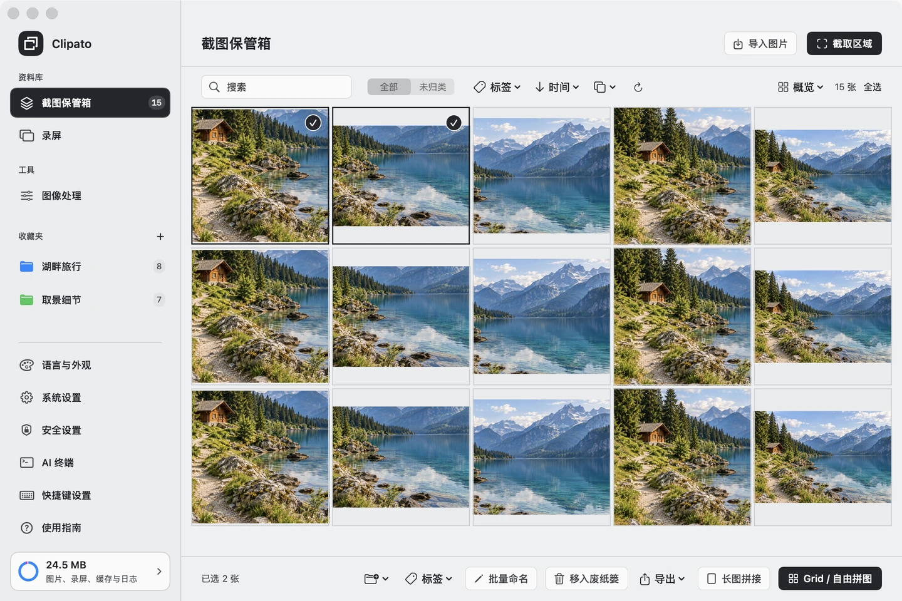

# Clipato

[简体中文](README.zh-CN.md) | **English**

Clipato is a screenshot, image pinning, screen recording, and image organization tool for **macOS 14 and later**. Capture your screen, keep reference images on top of other windows, organize your media, create stitched screenshots and collages, or batch compress, resize, and convert images.

Screenshots, recordings, and media are stored locally. Clipato stays in the menu bar, so you do not need to keep the Console open.

*Actual Clipato interface with sample images.*

## Features

| Feature | What you can do |
| --- | --- |
| Screenshots and annotations | Capture an area or the current screen; add rectangles, arrows, freehand drawings, text, and mosaic effects |
| Pinned images | Keep images on top of other windows; move and resize them for reference |
| Continuous capture and collages | Capture successive views, stitch long screenshots, or arrange images in grid and freeform collages |
| Screen recording | Record continuous MP4 video, or save keyframes only when the screen changes |
| Vault and collections | Search, filter, sort, preview, and organize images and recordings |
| Image processing | Batch compress, resize, convert, and rename images, or slice a single image into a grid |
| Duplicate and similarity detection | Find duplicate files and images with differences in quality or overlapping content |
| AI collaboration | Install the Clipato Skill for Codex or Claude Code, or connect another compatible client through MCP |

## Contents

- [Quick start](#quick-start)
- [Screenshots and pinned images](#screenshots-and-pinned-images)
- [Continuous capture and collages](#continuous-capture-and-collages)
- [Screen recording](#screen-recording)
- [Vault and collections](#vault-and-collections)
- [Image processing](#image-processing)
- [Exporting and sharing](#exporting-and-sharing)
- [Settings and data management](#settings-and-data-management)
- [AI collaboration](#ai-collaboration)
- [FAQ](#faq)
- [License](#license)

## Quick start

Choose the DMG for your Mac: **`arm64` for Apple Silicon (M-series chips)** or **`x86_64` for Intel**. Check **Apple menu → About This Mac** if you are unsure. Both versions require **macOS 14 or later**.

Copy the complete `Clipato.app` from the DMG to any local folder to run it; `Applications` is a convenient installation shortcut. After moving the app, reopen it from the new location, reinstall its Skill, and update any existing external MCP or CLI paths.

1. Open `Clipato.app`. Its icon appears in the macOS menu bar; the Console does not open automatically.
2. When you first capture or record the screen, follow the system prompts to grant Screen Recording permission. Quit and reopen Clipato if macOS asks you to do so.
3. Press `F1`, drag to select an area, add annotations if needed, then copy, save, or pin the image. In normal mode, completed screenshots are automatically added to the Vault.
4. Press `F2` to pin your latest image to the desktop.
5. Click the menu bar icon and choose **Console** to browse screenshots, recordings, and collections.

macOS may call the permission page **Screen & System Audio Recording**; this is the system's category name. Clipato captures only the screen, does not capture system audio, and does not request microphone permission.

### Default shortcuts

| Shortcut | Action |
| --- | --- |
| `F1` | Capture Area |
| `F2` | Pin Latest Image |
| `F3` | Start recording; press again while recording to stop and save |
| `F4` | Start Continuous Area Capture; press again to capture the next image |
| `F5` | Toggle pinned image click-through |

If your Mac uses the function keys for brightness or volume, try holding `Fn` / `🌐`, or assign a different shortcut in Clipato's **Keyboard Shortcuts** settings.

Clipato continues running in the menu bar after you close the Console. To quit completely, choose **Quit Clipato** from the menu.

## Screenshots and pinned images

### Capture your screen

1. Move the pointer to the display you want to capture, then press `F1` or choose **Capture Area** from the menu.
2. Before selecting an area, use the pixel magnifier and color value beside the pointer. Press `C` to copy the value or `Tab` to switch between HEX, RGB, and HSL. After copying, continue selecting an area or press `Esc` to exit.
3. Drag to create a selection; this hides the color information. After releasing the mouse, drag inside the selection to move it, or drag an edge handle to resize it.
4. Add annotations with the floating toolbar, or finish the screenshot directly.
5. Copy, save, or pin the image. When you are not entering text, press `Enter` to finish and copy, or `Esc` to cancel.

Color values come from the original screenshot pixels in sRGB. HEX is the default; choose HEX, RGB, or HSL under **System Settings → Screenshots & Color Picking → Default Color Format**. Switching with `Tab` applies only to the current screenshot and does not change that default.

The full-screen crosshair is on by default. Turn it off or on under **System Settings → Screenshots & Color Picking → Show Full-Screen Crosshair**.

Choose **Capture Current Screen** to capture the entire display under the pointer and open it for annotation.

Each capture is limited to one display. To capture another display, move the pointer there before starting.

### Add annotations

- **Rectangles, arrows, and freehand drawing**: highlight areas, indicate directions, or draw freely.
- **Text (T)**: click the image to enter text and adjust its color and size. `Enter` adds a line break; `⌘Enter` finishes text entry. You can then drag the text or double-click it to edit again.
- **Mosaic**: cover a rectangular area or paint over it, with adjustable pixel and brush sizes.
- **Edit annotations**: select text or a shape and press `Delete` to remove it. Use `⌘Z` to undo and `⇧⌘Z` to redo. Adjust mosaic strokes with undo and redo.

You can also annotate Vault images from their context menu. Zooming the view does not change the image's actual resolution.

### Pin images

Pinning from the screenshot toolbar places the image at the current selection's position. You can also pin an image from its context menu in the Vault, or press `F2` to pin the latest image in recent-image history.

Pinned windows stay on top of other windows. Drag to move, scroll to resize, right-click to copy, and double-click or press `Esc` to close.

Press `F5`, or select **Pinned Image Click-Through** from the menu bar menu, to send mouse actions through all pinned images to the windows underneath. Press it again or clear the menu item to interact with pinned images again. Customize this shortcut in **Keyboard Shortcuts**.

`F5` is included on first launch and when restoring defaults. If you already saved a shortcut configuration, assign this new action in **Keyboard Shortcuts**; your existing bindings stay intact.

## Continuous capture and collages

### Create a long screenshot with continuous capture

Use this for web pages, conversations, documents, and step-by-step instructions. You scroll the page and trigger each capture manually.

1. Press `F4` or choose **Continuous Area Capture** from the menu. Select and confirm an area to take the first screenshot.
2. Scroll the page, keeping some content in common with the previous capture, then press `F4` or click the capture button on the floating toolbar.
3. Repeat as needed. When finished, use the toolbar's finish action to open the collage workspace in long screenshot mode.
4. Check the automatic stitching result. If needed, adjust the tolerance range and click **Auto Stitch** again, or drag images and adjust seams manually.
5. Copy or export the result and choose where to save it.

During continuous capture, drag the floating toolbar's move handle to reposition the capture area. Guides remember the first capture's position and snap to it when nearby. Hold `Option` to temporarily disable snapping. After clicking the move handle, you can also use the arrow keys for fine adjustments or return to the first capture's position.

Automatic stitching needs shared text or graphics between images. Repeated patterns, fixed headers, and animations can affect alignment. Use **Undo Stitch** or adjust the layout manually if the result is unsuitable.

### Grid and freeform collages

Select images in the Vault and click **Grid / Freeform**. In a collection, select images and click **Collage · N Images**. Choosing **Stitch** opens the same workspace in long screenshot mode.

| Mode | How to use it |
| --- | --- |
| Grid | Set rows, columns, maximum image dimensions, and spacing to arrange images in regular cells |
| Freeform | Drag, resize, overlap, and reorder layers; optionally arrange images automatically |
| Long screenshot | Automatically align adjacent captures, or adjust image positions and seams manually |

Drag the thumbnails at the top to reorder images. The preview supports zooming and fitting to the window; its zoom level does not affect export dimensions. Clipato asks for confirmation before closing a workspace with unsaved changes.

## Screen recording

Screen recording **does not support audio recording and captures neither system sound nor microphone input**. Recordings are mainly intended for later review and capturing still images from individual frames.

### Choose a recording type

Open **System Settings → Recordings** to choose the type for your next recording:

| Recording type | Best for | Saved content |
| --- | --- | --- |
| Direct recording · MP4 | Continuous screen activity for later review and frame captures | An MP4 video |
| Keyframes | Documents, slides, and instructions with infrequent screen changes | Images saved when the screen changes, plus a timeline; exportable as MP4 or GIF |

**Advanced Options** is collapsed by default. Expand it to adjust the frame rate, maximum dimension, and other parameters. Keyframe sampling supports 1, 2, or 4 frames per second; a lower change threshold records smaller changes.

### Start, pause, and stop

1. Press `F3`, start a recording from the menu bar, or click **Start Recording** on the Recordings page.
2. Select and adjust the recording area, confirm the recording type on the toolbar, then start.
3. A green border marks the recording area. Use the floating toolbar to pause, resume, or stop. Paused time is excluded from the recording.
4. Click stop or press `F3` again to finish and save.
5. Open **Recordings** in the Console to view the result. Double-click to play.

Move the pointer to the target display before starting. The recording area is fixed once recording begins.

### Play and export keyframe recordings

The export menu for a keyframe recording offers:

- **MP4 / GIF**: play each frame for its original duration.
- **Export to Vault**: save the keyframes as separate images in chronological order for annotation or collages.

The original recording is retained. You can also open `player.html` in its recording folder for offline playback. To share a keyframe recording this way, copy the entire folder.

## Vault and collections

### Import, find, and display media

Click **Import Images** at the top of **Screenshot Vault** to import PNG, JPEG, HEIC, and other images readable by macOS. Supported formats depend on the file picker and system decoders. Importing preserves the original filename and file contents.

The Vault, Recordings, and collections support:

- Search, color tag filters, and sorting by time, file size, or name in ascending or descending order.
- **Overview**: the default mode, showing thumbnails in equally sized cells without bottom details. Hover to see collection badges.
- **Cards**: show names, file sizes, and other details appropriate to the media type.

The Vault and Recordings also offer an **All / Unfiled** filter. Unfiled shows media that has not been added to any collection. Adding an item to a collection removes it from this filtered view; it remains available under All.

### Select items and preview images

| Action | Result |
| --- | --- |
| Click | Select one item |
| `⌘` + click | Add or remove an item from the selection |
| `⇧` + click | Select a range from the selection anchor to the clicked item in the current sort order |
| `⌘A` | Select all items in the current filtered view; inside a text field, select its text instead |
| Double-click an image, or select it and press Space | Open the image preview |
| Press `←` / `→` in the preview | Move to the previous or next image in the current list order |
| Press Space or `Esc` in the preview | Close the image preview |

The image preview supports zooming, 100% actual pixels, and fitting to the window. When supported by the system, Live Text lets you select and copy text in images. Recognition depends on the image, language, and system support.

### Organize media with collections

Click `＋` beside **Collections** in the sidebar to create a collection. Right-click a collection to rename it, choose its folder color, change its order, or delete it.

Drag media from the Vault or Recordings list onto a sidebar collection to add it. You can also organize a selection with the **Add to Collection** menu.

Collections have a single level and cannot be nested. An image or recording can belong to multiple collections. They reference the same original file, so organizing media does not create extra copies.

| Action | Effect on the original file |
| --- | --- |
| Add to a collection | Add a collection membership; retain the original |
| Remove from a collection | Remove only that membership; retain the original and other memberships |
| Delete a collection | Delete the collection and its memberships; retain the originals |
| Move to Trash | Move the original file and remove it from all related collections |

When you manually move collected media to Trash, the confirmation identifies the affected collections. Files can be recovered from the system Trash; removed collection memberships need to be recreated.

## Image processing

### General workflow

Compression, resizing, format conversion, and grid slicing use this workflow. Batch renaming and detection are described below.

1. Open **Image Processing** in the sidebar and choose a tool.
2. Under **Choose Image Source**, select **External Images** or **Screenshot Vault**.
3. Select your images, adjust the settings, and review the preview or output plan. Use the breadcrumbs or **Back** to change your selection.
4. Click **Choose Location and Export…** to save the results.

Compression, resizing, format conversion, and grid slicing create new files and retain the originals. **Batch Rename changes the selected filenames directly**, including external files. Review the naming preview before applying it.

### Compress, resize, and convert

| Tool | Key options |
| --- | --- |
| Compress Images | Set a target size per image; optionally allow resizing when needed to preserve as much quality as possible within that size |
| Resize Images | Choose one or more output sizes, with proportional fitting, white padding, center cropping, and custom width and height |
| Convert Format | Export JPEG, PNG, or WebP; JPEG fills transparent areas with white, while PNG and WebP can retain transparency |

You can combine these operations on the same page, such as resizing images, converting their format, and compressing them to a target size. Animated images are processed using only their first frame; animation is not preserved. Clipato asks you to adjust the settings if the target size cannot be reached or the dimensions are outside the supported range.

### Grid slicing

1. Select one image and open **Grid Slicing**.
2. Adjust the square crop first: drag inside the selection to move it, drag its corners to resize it, or enter its width and height.
3. Click **Next: Grid Settings** and choose a **4-tile** or **9-tile** grid.
4. Set the tile size and **Source Gap**, then check the publishing layout preview.
5. Export and publish the numbered tiles from left to right, then top to bottom.

**Source Gap skips the corresponding source pixels when generating the tiles** to compensate for the gaps between tiles on the publishing platform. As a result, joining the exported tiles without gaps will not reconstruct the complete original. Set the gap to `0` if you do not need this compensation.

### Batch rename

Select at least two images, or select at least two complete videos in Recordings or a collection, then open **Batch Rename**. All selected items must be of the same type. Keyframe recording archives are excluded from batch renaming.

Set the **prefix, starting number, increment, and number of digits**. Compare the original and proposed names, then click **Apply Rename**. Numbering follows the current list order, and file extensions are preserved.

For example, naming JPG images with the prefix `Trip_`, a starting number of `1`, and `3` digits produces names such as `Trip_001.jpg` and `Trip_002.jpg`.

### Find duplicate files and similar images

Open **Image Processing → Find Duplicates and Similar Images**, then choose a detection method and image source. To check complete videos, first select at least two complete videos in Recordings or a collection, then open the **Find Duplicates and Similar Images** menu at the top, marked by overlapping squares, and choose **Find Duplicate Files**.

| Detection method | Supported media | Purpose |
| --- | --- | --- |
| Find Duplicate Files | Images and complete videos | Find files with identical contents, even if their filenames differ |
| Find Similar Images | Images | Find candidates that differ in quality or dimensions, or contain part of another image |

Detection does not delete anything automatically. Preview each group, select unwanted items, then click **Move to Trash** and confirm. Similarity results are candidates; you decide which items to keep.

## Exporting and sharing

Select images in the Vault or a collection and open the **Export / Export Images** menu. Batch exports follow the current display order.

| Export option | Results and settings |
| --- | --- |
| Images / PDF… | Export separate PNG or JPEG files, or create a PDF with one image per page; JPEG and PDF support quality adjustment |
| ZIP Archive… | Package files in the chosen format for sharing multiple images together |
| MP4 / GIF… | Turn multiple images into a video or animation; quick options offer 1, 5, and 15 fps, with custom values under Advanced Options |

PNG output is lossless. For JPEG and PDF, `100%` means the highest encoding quality. In MP4 and GIF exports, each image becomes one frame. Lower frame rates keep each image on screen longer; the minimum is `1 fps`.

For WebP, use **Image Processing → Convert Format**. Separate image exports do not directly overwrite files with the same name. For single-file exports such as PDF, ZIP, MP4, and GIF, confirm replacement in the system save dialog if you choose an existing file.

## Settings and data management

### Language, appearance, and shortcuts

Under **Language & Appearance**, choose system, light, or dark appearance, select a color scheme, and adjust the Console font size. The interface language follows the system by default and supports English, Simplified Chinese, Traditional Chinese, Japanese, Korean, and Tibetan.

In **Keyboard Shortcuts**, click a shortcut field and press the new key combination. You can clear a binding or restore defaults. Choose **Disable Shortcuts** from the menu to temporarily disable global shortcuts while keeping their settings.

### Save locations and storage limits

- **System Settings → Save Locations**: choose separate locations for screenshots and images, and for recordings. New locations apply to future content; existing files are not moved automatically.
- **System Settings → Storage Management**: set a shared limit for images and recordings. Storage is unlimited by default. Click **Save Settings** after making changes.
- **Storage ring at the bottom of the sidebar**: inspect space used by images, recordings, caches, and access logs. Logs count toward total disk usage, but not toward the image and recording storage limit.

Automatic cleanup is off by default. When enabled, it moves only the oldest eligible images to Trash; **recordings are not deleted automatically**. By default, collected images, color-tagged images, and images from the last 7 days are protected.

Moving files to Trash does not release their disk space until the system Trash is emptied.

### Automatic screenshot and recording names

Open **System Settings → Automatic Naming**, edit the screenshot and recording rules separately, check the previews, and click **Save Settings**. Rules apply to newly created screenshots and recordings. Existing files, imports, and output names explicitly supplied by CLI or MCP are unchanged. Keyframe recordings display the recording name while keeping their internal frame sequence unchanged.

| Syntax | Meaning |
| --- | --- |
| Fixed text | Your own prefix or separator, such as `ProjectA_` |
| `{date}` | Date in `yyyy-MM-dd` format |
| `{time}` | Time in `HH.mm.ss` format |
| `{index}` | Incrementing number with at least 3 digits by default, such as `001` |
| `{index:4}` | Pad to at least 4 digits; supports 1–12 digits and expands when needed |

The default screenshot rule is `截图 {date} {time}_{index}`, for example `截图 2026-10-20 14.30.00_001.png`. Recordings use `录屏` as their default prefix. Replace this text with your preferred prefix. The output format adds the extension automatically; do not include it in a rule.

Screenshots and recordings use separate number sequences that continue after restarting. Saving a rule does not reset the sequence. Previews do not use a number; cancelled or failed operations may leave gaps.

### Permission status

Open **Security Settings → Permissions → Screen Recording** to see **Authorized / Not Authorized**. Choose **Grant Access** when permission is missing or **Manage Permissions** when it is granted; both open the relevant macOS settings page. Screenshots and recordings share this permission. Clipato captures only the screen, not system audio or microphone input.

The draggable `Clipato.app` card in Security Settings points to the app you are currently using. If the system page does not accept a drop, click **+** in the Screen Recording list, select the current app, and turn its switch on. The app can be in any local folder. Returning to Clipato refreshes the status; if it still shows Not Authorized, quit Clipato completely and reopen it.

### Launch at login

**Security Settings → Launch at Login** is off by default. Enable it to start Clipato in the menu bar automatically when you log in to your Mac. Installing Clipato, launching it, or opening settings does not add a login item. The app requests registration only when you select this checkbox.

You can select the checkbox on first use, before a login item has been registered. If registration fails, Clipato shows the error returned by macOS.

The switch shows **On / Awaiting Approval / Off**. Awaiting Approval means you must allow it in macOS Login Items settings.

If macOS requires approval, click **Open Login Items Settings** and allow Clipato there. Turn the option off to remove its login item.

To add it manually, click **Open Login Items Settings** to open the system page, then drag the `Clipato.app` icon provided in Clipato's settings into **Open at Login**. You can also click **+** below the system list and select this app. The button and drag source do not register a login item themselves; manual setup takes effect only after you add the app in System Settings.

### Privacy mode

Open **Security Settings → Privacy** and select **Enable Privacy Mode**. It is off by default.

When enabled, screenshots are not automatically added to the Vault, and new recent-image history is not recorded. Existing media and history are retained. Explicit saves, exports, and screen recordings still write files to their respective locations.

Privacy mode turns off **Allow External Automation Calls** and **Enable MCP Service**, and prevents them from being enabled. Leaving privacy mode restores neither switch. To use Skills or CLI again, manually enable **Allow External Automation Calls** under **AI Terminal → Automation Access**; MCP also requires its separate service switch.

### Clear operation history and clean up data

These actions affect different data:

| Location | What is cleared |
| --- | --- |
| Menu bar menu → Clear Operation History | Recent-image history; media, currently pinned windows, and the system clipboard are retained |
| Bottom of System Settings → Clean Up Data… | Choose Vault images, recordings, collections, and operation history separately on the confirmation page, then run cleanup |

Cleaning up media moves its files to the system Trash. Selecting only collections does not delete the original media. Deleted collections and operation history cannot be restored within the app; settings are retained. Finish any active capture, recording, editing, or image processing operation before cleaning up data.

### Check for updates

Open **System Settings → About & Updates** to view the current version and click **Check for Updates**.

When a new version is available, read the release notes and click **Go to Download**. Update checks run only when you request them; new versions are not installed automatically.

Each Mac can make up to **5 HTTP update requests per local calendar day**, resetting at midnight. Failed requests, each backup URL, and HTTPS redirects each count toward the limit; restarting the app does not reset it. After the limit is reached, Clipato shows the last successful result with its check time, including an “up to date” result. Failed checks do not replace that cache. If no successful result is cached, Clipato asks you to try again the next day.

## AI collaboration

This feature is optional. Screenshots, recordings, and image processing in the app do not require it. Skills, MCP clients, and command-line operations require **Allow External Automation Calls**. MCP additionally requires **Enable MCP Service**. Both switches are off by default and cannot be enabled in privacy mode; Skills and ordinary CLI commands work with the MCP service off.

### Install the Clipato Skill

1. Open **AI Terminal → Automation Access** and select **Allow External Automation Calls**.
2. In **Skills**, click **Install to Codex** or **Install to Claude Code**. No MCP connection is needed.
3. Start a new conversation in that client on the same Mac, then ask Clipato to capture the screen, organize media, or process images. In Codex, you can explicitly invoke `$clipato`; in Claude Code, use `/clipato`.

| Option | Where the Skill is saved |
| --- | --- |
| Install to Codex | `~/.agents/skills/clipato` |
| Install to Claude Code | `~/.claude/skills/clipato` |
| Export Skill… | A `clipato` folder inside the location you choose |

If the destination already exists, Clipato asks before replacing its entire contents. Other Skills and client configuration are retained. The exported Skill is intended for a local client that can run commands on this Mac; uploading it to Claude on the web does not grant access to your Mac. After moving `Clipato.app`, reopen it from the new location and reinstall or export the Skill again to update its executable path.

For example: “Compress these images to 500 KB each and keep the originals,” or “Preview a batch renaming plan; do not apply it before confirmation.” Screenshot and screen recording calls still require macOS Screen Recording permission.

### Connect through MCP

1. Enable **Allow External Automation Calls** under **AI Terminal → Automation Access**.
2. Under **AI Terminal → MCP Service**, select **Enable MCP Service**. This separate switch starts off even if you allowed external calls in an earlier version.
3. Click **Copy MCP Configuration**, add it to your client, and reload its connection. Configuration copying is available only while both switches are on. The `clipato mcp` command also requires both switches.

You can also select **Enable MCP Service** directly. If the master switch is off, Clipato asks you to confirm external automation access before enabling both switches. Canceling leaves permissions unchanged.

Turning off **Enable MCP Service** disconnects MCP sessions and cancels their active tasks. Skills, ordinary CLI calls, and their active tasks remain permitted while the master switch is on. Turning the service off and on does not restore an old MCP session; reconnect your client.

While **Allow External Automation Calls** is off, all Skill, MCP, and command-line business calls are blocked, including calls from previously connected clients. Turning it off also turns off the MCP service, revokes existing sessions, and cancels all active automation tasks with cleanup. Completed writes are not undone. Enabling the master switch again leaves the MCP service off; enable it separately and reconnect your client if needed. Command-line help, version information, `permissions` diagnostics, and `tools [NAME]` capability definitions remain available while both switches are off.

**Allow Automation Requests to Move Items to Trash** is off by default. Even when enabled, each batch requires your confirmation in Clipato. Automation does not provide permanent deletion or a tool to clear all data at once.

View MCP and all command-line calls under **Access Log → View Log**, including original arguments, outcomes, and duration. Process information comes from the system; MCP client names and versions are self-reported. Logging does not read image file contents or store complete responses.

Set the total log storage limit under **AI Terminal → Access Log**. The default is **20 MB**; enter an integer from **1–1024 MB** and save. The active log and rotated files share this limit. The oldest log files are deleted automatically when the limit is exceeded; lowering the limit also removes older logs.

If you move the app, reinstall its Skill and copy its MCP configuration again to update the executable paths.

## FAQ

### Why is there no window after launch?

Clipato runs in the menu bar by default. Click its menu bar icon and choose **Console** to open it. Closing the Console does not quit the app.

### What if screenshot or recording permission is denied?

Check the status under **Security Settings → Permissions → Screen Recording** and click **Grant Access**, or click **Open Screen Recording Permissions** in the **User Guide**. Follow the macOS prompts; returning to Clipato refreshes the status. If it still shows Not Authorized, quit Clipato completely and reopen it. When using an AI client or terminal, grant permission to the application identified by the system prompt.

### Why does F2 do nothing?

When there is no recent-image record, **Pin Latest Image** is disabled and `F2` does nothing. After clearing history or deleting the image referenced by that record, complete another screenshot, import an image, or explicitly pin an image to create a new record. New screenshots do not update this history in privacy mode.

### Does a large library load every original image at once?

Lists load thumbnails as needed. The corresponding images are read when you open a preview, edit them, or run processing. Reducing output dimensions can lower memory use when batch processing large images.

### Why did converting an image make the file larger?

File size depends on the format, image contents, and encoding quality. PNG preserves lossless pixels and is not necessarily smaller than JPEG. To meet an upload limit, use **Compress Images** and set a target file size.

### What limitations should I know about?

- Screen recording does not support audio recording. Capture and recording areas cannot span multiple displays.
- Image processing and similarity detection use only the first frame of animated images.
- Live Text depends on system support. Text search across the entire Vault is not currently available.
- Similarity detection requires human review. Stitching screenshots with complex content may need manual adjustments.

## License

Clipato is licensed under the [MIT License](LICENSE). Copyright (c) 2026 ehehrun.

Third-party components retain their original terms. See libwebp's [license](Vendor/libwebp/COPYING) and [patent grant](Vendor/libwebp/PATENTS).
